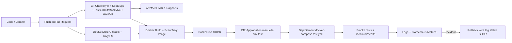

# Darna Web — Chaîne DevOps Complète (L3 DSI)

Version web de l'application **DARNA** (gestion de résidences et de copropriétés en Tunisie), dotée d'une chaîne DevOps automatisée de bout en bout (Git, CI, qualité logicielle, tests, Docker/GHCR, DevSecOps, CD, supervision Prometheus et rollback).

---

## 1. Architecture de la chaîne DevOps



---

## 2. Acteurs & Fonctionnalités de l'application

- **Visiteur (sans compte)** : catalogue public des appartements disponibles (`/`), filtrage par typologie (`S+0`..`S+3`) et loyer max (TND), location en ligne avec création automatique de compte résident.
- **Propriétaire / Syndic (`OWNER`)** : gestion des appartements (`/apartments`), émission des charges (`/charges`), suivi des recouvrements, affectation des pannes (`/repairs`).
- **Résident (`RESIDENT`)** : consultation et règlement partiel ou total des charges (Carte / Virement), signalement d'incidents techniques.
- **Ouvrier (`OUVRIER`)** : consultation des interventions assignées avec localisation complète et clôture chiffrée en TND.

---

## 3. Démarrage rapide

### Mode Développement (`dev`) avec Docker Compose
1. Copier le gabarit de configuration (ne jamais commiter `.env`) :
   ```bash
   cp .env.example .env
   ```
2. Lancer PostgreSQL + Darna Web :
   ```bash
   docker compose up -d --build
   ```
3. Accéder à `http://localhost:8080` (ou `http://localhost:8080/actuator/health`).

### Exécuter la suite qualité et tests localement
```bash
mvn -B clean verify -Dspring.profiles.active=ci
```

---

## 4. Livrables DevOps

- Guide de contribution & stratégie Git (Lot 1) : [CONTRIBUTING.md](CONTRIBUTING.md)
- Matrice des environnements, secrets & DevSecOps (Lot 5) : [docs/CONFIG_MATRIX.md](docs/CONFIG_MATRIX.md)
- Guide de supervision, diagnostic d'incident & rollback (Lot 7) : [docs/SUPERVISION_ET_INCIDENTS.md](docs/SUPERVISION_ET_INCIDENTS.md)
- Fiche d'incident (Lot 7) : [docs/FICHE_INCIDENT.md](docs/FICHE_INCIDENT.md)
- Plan de soutenance, indicateurs & fiche de remise : [docs/FICHE_REMISE_ET_SOUTENANCE.md](docs/FICHE_REMISE_ET_SOUTENANCE.md)
- Support de présentation (soutenance) : [docs/PRESENTATION_SOUTENANCE.md](docs/PRESENTATION_SOUTENANCE.md)
