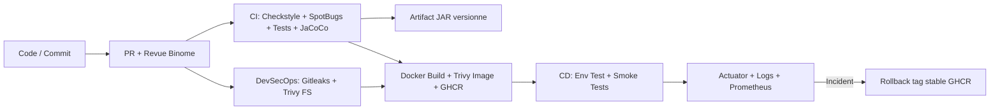

# Présentation Synthétique de Soutenance — Darna Web (Chaîne DevOps)

> Support structuré en 11 diapositives pour la soutenance finale (Licence 3 DSI — Atelier Chaîne DevOps).

---

## Slide 1 — Page de garde
- **Titre :** Conception et mise en œuvre d'une chaîne DevOps complète
- **Application support :** **Darna Web** — Gestion de résidences et de copropriétés en Tunisie
- **Binôme :** Amir Menzli & Souha Bouagila (L3 TI — DSI)
- **Dépôt GitHub :** `https://github.com/souha581/darna-web`

*Note orale :* Nous présentons l'industrialisation complète de l'application web Darna, depuis le commit développeur jusqu'au déploiement en environnement de test, la supervision et le rollback.

---

## Slide 2 — Contexte, Problématique & Application Support
- **Problématique initiale :** livraisons manuelles, écarts entre environnements (`dev` vs `test`), absence de tests automatisés et retour arrière risqué.
- **Application Darna Web :**
  - **Backend & UI :** Java 21, Spring Boot 3.4, Spring Security (RBAC), Spring Data JPA, Thymeleaf + API REST.
  - **Base de données :** PostgreSQL (`dev` & `test`), H2 en mémoire (`ci`).
  - **Acteurs & cas métier testables :**
    1. *Visiteur* : catalogue public (`/`), filtrage `S+0..S+3` et loyer max (TND), location en ligne.
    2. *Propriétaire (`OWNER`)* : gestion des appartements, émission de charges, affectation d'ouvriers.
    3. *Résident (`RESIDENT`)* : règlement partiel/total des charges, signalement de pannes.
    4. *Ouvrier (`OUVRIER`)* : suivi et clôture chiffrée des interventions en TND.

---

## Slide 3 — Vue d'ensemble de la Chaîne DevOps

---

## Slide 4 — Lot 1 : Organisation Git & Collaboration en Binôme
- **Stratégie de branches :** `main` (protégée), `develop` (intégration), branches `feat/*`, `fix/*`, `docs/*`.
- **Qualité Git :** Conventional Commits (`feat:`, `fix:`, `ci:`, `test:`, `sec:`, `ops:`), `CONTRIBUTING.md`, `.github/PULL_REQUEST_TEMPLATE.md`.
- **Revue croisée :** 8 Pull Requests créées, relues et approuvées entre les deux membres du binôme avant fusion dans `develop` et `main`.
- **Répartition du binôme :**
  - *Étudiant A (Intégration & Qualité)* : Git, `ci.yml`, Maven, Checkstyle, SpotBugs, tests JUnit/MockMvc, JaCoCo.
  - *Étudiant B (Livraison & Exploitation)* : `Dockerfile`, `docker-compose*.yml`, GHCR, secrets/configs, Gitleaks/Trivy, `cd.yml`, Prometheus & rollback.

---

## Slide 5 — Lots 2 & 3 : CI, Qualité Logicielle & Tests Automatisés
- **Pipeline as Code (`.github/workflows/ci.yml`) :** déclenché sur `push` et `pull_request` avec cache Maven (`actions/setup-java@v4`).
- **Contrôles qualité automatisés :**
  - **Checkstyle** (`0` violation) : respect du formatage et des conventions Java.
  - **SpotBugs** (`0` anomalie) : analyse statique du bytecode.
  - **Tests automatisés (`12` tests sur profil `ci`) :** tests unitaires (`DarnaServiceTest`), API REST (`DarnaApiIntegrationTest`) et Web UI (`DarnaWebControllerTest`).
  - **Quality Gate JaCoCo :** couverture minimale imposée à **55 %** (pipeline bloqué si inférieur — démontré lors d'un échec initial à 47 % puis corrigé par l'ajout de tests Web).
- **Artefacts :** JAR versionné (`darna-web-1.0.0-<sha>`) + rapports Surefire/JaCoCo/SpotBugs archivés.

---

## Slide 6 — Lot 4 : Conteneurisation & Registre GHCR
- **`Dockerfile` multi-stage :**
  - Stage 1 (`maven:3.9.9-eclipse-temurin-21`) : build reproductible du JAR.
  - Stage 2 (`eclipse-temurin:21-jre-jammy`) : image légère, utilisateur non-root `appuser`, `HEALTHCHECK` intégré sur `/actuator/health`.
- **Orchestration locale (`docker-compose.yml`) :** `app` + `postgres:16-alpine`, réseau bridge dédié, volume persistant et dépendance `service_healthy`.
- **Registre :** publication automatique sur **GitHub Container Registry (`ghcr.io/souha581/darna-web`)** avec tags explicites (`sha-<commit>`, `develop`, `latest`).

---

## Slide 7 — Lot 5 : Configurations, Secrets & DevSecOps
- **Séparation des environnements (`docs/CONFIG_MATRIX.md`) :**
  - `application-dev.yml` (PostgreSQL `darna_dev`, logs `DEBUG`)
  - `application-test.yml` (PostgreSQL `darna_test`, mot de passe obligatoire)
  - `application-ci.yml` (H2 en mémoire pour la CI)
- **Gestion des secrets :** aucun mot de passe en clair dans le dépôt, `.env` ignoré par `.gitignore`, gabarit `.env.example`, secrets stockés dans **GitHub Actions Secrets**.
- **Contrôles DevSecOps :**
  - **Gitleaks** : détection de secrets sur l'historique Git.
  - **Trivy FS & Trivy Image** : scan des dépendances Maven et de l'image Docker (`trivy-fs-report`, `trivy-image-report`).
  - **Remédiations appliquées :** suppression des mots de passe par défaut dans `application.yml` et exécution non-root dans `Dockerfile`.

---

## Slide 8 — Lot 6 : Déploiement Automatisé (`cd.yml`) & Vérifications
- **Environnement de test distinct (`docker-compose.test.yml`) :** port `8081`, base `postgres-test` dédiée, image tirée depuis GHCR.
- **Workflow `.github/workflows/cd.yml` :**
  - Déclenchement automatique après succès de `CI Pipeline` sur `main` (ou manuel via `workflow_dispatch`).
  - Support de l'environnement protégé GitHub `test` (approbation manuelle possible).
  - **Smoke tests automatisés (`scripts/smoke-test.sh`) :** vérifie `/actuator/health` (`UP`), `/actuator/info` (version déployée), `/`, `/login` et `/api/apartments`.
  - **Traçabilité :** enregistrement dans `deployments/history.log` archivé comme artefact.

---

## Slide 9 — Lot 7 : Supervision, Incident Contrôlé & Rollback
- **Observabilité :**
  - Sonde `/actuator/health` et infos de version `/actuator/info`.
  - Métriques JVM + compteurs métier (`darna.rentals.completed`, `darna.charges.paid`, `darna.repairs.reported`) exposés via `/actuator/prometheus` et collectés par **Prometheus** (`http://localhost:9090`).
  - Journaux applicatifs dans `logs/darna-web.log` et `docker compose logs`.
- **Incident simulé & diagnostic (`docs/FICHE_INCIDENT.md`) :**
  - Erreur de configuration PostgreSQL (`DB_PASSWORD` erroné) → échec immédiat de `/actuator/health` → diagnostic via les logs `HikariPool` / `FATAL: password authentication failed`.
- **Rollback automatisé :**
  - Workflow `.github/workflows/rollback.yml` + `scripts/rollback.sh` / `rollback.ps1` restaurant le tag GHCR stable précédent avec vérification par smoke tests (< 60 s).

---

## Slide 10 — Indicateurs & Bilan
- **Résultats obtenus :**
  - 100 % des 7 lots implémentés et automatisés de bout en bout.
  - Exécution CI complète en ~1 min 50 s grâce au cache Maven et Docker Buildx.
  - Blocage effectif des régressions (testé sur le seuil JaCoCo et les scans de sécurité).
- **Limites & Perspectives :**
  - Environnement `test` hébergé via Docker Compose (absence de cluster Kubernetes ou serveur cloud permanent).
  - Améliorations possibles : intégration SonarQube, tableau de bord Grafana et notifications d'alerte (Slack/Email).

---

## Slide 11 — Plan de Démonstration en Direct (Live Demo)
1. Montrer le dépôt GitHub (`main`, `develop`, PRs fusionnées, **Packages** GHCR).
2. Faire une petite modification sur une branche et montrer le déclenchement de **CI Pipeline**.
3. Montrer dans **Actions** : Checkstyle/SpotBugs/Tests, artefacts (`quality-reports`, `trivy-*`, `darna-web-*.jar`) et **CD Deploy to Test**.
4. Sur la stack Docker locale (`docker-compose.test.yml`) : vérifier `http://localhost:8081`, `/actuator/health` et Prometheus `http://localhost:9090`.
5. Simuler l'incident contrôlé, diagnostiquer dans les logs et exécuter le **Rollback** (`scripts/rollback.ps1` ou `rollback.yml`).
